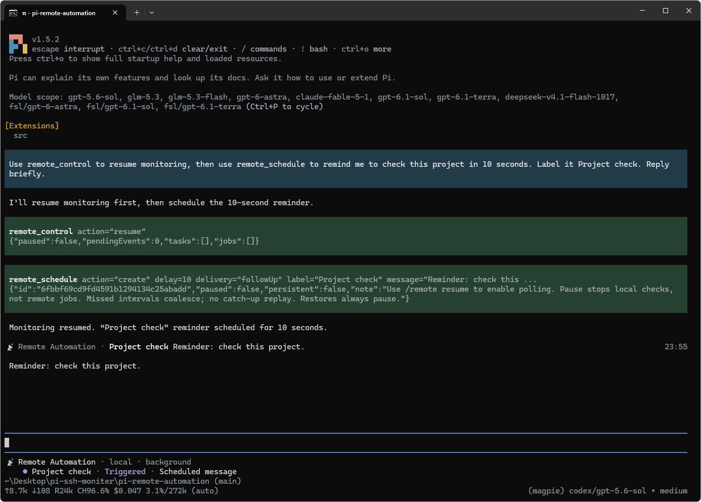

# pi-remote-automation

在 Pi 中监视本机或 SSH 目标上的任务，在条件满足时接收更新。你可以设置提醒、等待结果文件，或查看后台作业，无需离开会话。

监视和定时任务需要 Pi 会话保持运行。新建和恢复的会话初始都处于暂停状态。

[English](README.md) | 简体中文

[快速开始](#快速开始) · [使用示例](#使用示例) · [SSH 配置](#ssh-配置) · [查看和控制监视](#查看和控制监视) · [工具](#工具) · [生命周期和通知限制](#生命周期和通知限制)

Pi 中的本机提醒：



## 快速开始

在 Windows、Linux 或 macOS 上安装 Node.js 22 或更高版本，以及支持包管理的 Pi。在终端中将 `OWNER/REPO` 替换为实际仓库地址：

```bash
git clone https://github.com/OWNER/REPO.git
```

使用检出目录的绝对路径安装：

```bash
# POSIX
pi install "/absolute/path/to/pi-remote-automation"
```

```powershell
# Windows PowerShell
pi install "C:/absolute/path/to/pi-remote-automation"
```

Pi 直接从检出目录加载包，不会复制文件。重启 Pi，或在已有会话中运行 `/reload`。安装默认使用个人设置，添加 `-l` 可使用项目设置。运行 `pi list` 查看包，运行 `pi remove <source>` 移除包。

在终端中进入项目目录并启动 Pi：

```bash
# POSIX
cd /path/to/project
pi
```

```powershell
# Windows PowerShell
cd C:/work/project
pi
```

自动化默认使用本机和 Pi 的当前目录。本机使用无需配置 SSH 或部署 runner。如需使用其他本地目录，启动 Pi 时运行 `pi --automation-target local --automation-cwd <absolute-project-path>`。

在 Pi 中运行 `/remote resume`，然后输入：

> 用 remote_schedule 在 10 秒后提醒我检查这个项目。

约 10 秒后，Pi 应收到一条提醒更新。在 Pi 中运行 `/remote activity` 查看活动。等待时请保持会话运行。

## 使用示例

在 Pi 中输入以下提示。允许 Pi 执行命令前，请先检查它提出的命令。

- 每 30 秒检查一次 `result.json` 是否出现，出现后通知我一次。不要启动或修改任何作业。
- 10 秒后提醒我检查这个项目。
- 启动我指定的后台作业，然后查看其状态和输出。

文件检查使用在所选目标上运行的自定义 JSON 探针，没有内置文件监视器。探针和作业命令可以执行任意代码，只授权你打算运行的命令。

## SSH 配置

在本机安装 OpenSSH 客户端，在目标上安装 Node.js 22 或更高版本。配置 SSH 别名，使用非交互式认证，并在 `known_hosts` 中保存已验证的主机密钥。在终端中启动 Pi，指定目标的绝对目录和平台：

```bash
# POSIX 目标，使用 sh 登录
pi --automation-target ssh:lab --automation-cwd /srv/project --automation-platform posix
```

```powershell
# Windows 目标，使用 PowerShell 登录
pi --automation-target ssh:lab --automation-cwd C:/work/project --automation-platform win32
```

在 Pi 中运行 `/remote doctor`，然后显式运行 `/remote deploy-runner` 和 `/remote resume`。部署会将随包提供的 runner 复制到 SSH 用户的状态目录。这些参数只影响自动化工具，不影响普通 Pi 工具。显式 SSH 不会回退到本机执行。

## 查看和控制监视

在 Pi 中用 `/remote activity` 查看活动，用 `/remote doctor` 查看可用能力。用 `/remote pause` 停止检查并暂停通知，用 `/remote resume` 恢复监视。暂停不会停止作业。连续三次探针出错后被禁用的监视不会因恢复监视而重新启用，需要重新创建。

用 `/remote clear` 移除当前会话的监视、定时任务、作业监视注册、尚未提交的事件和 Activity 历史。该命令会保存空状态，并使监视保持暂停。恢复监视不会找回已清除的注册。也可以让 Pi 调用 `remote_control`，将 `action` 设为 `"clear"`。

清空不会终止作业、删除目标文件、清除对话或撤回已提交给 Pi 的通知。它还会丢弃作业的本地所有权记录。重新附加这些作业后只能观察。`/remote activity clear` 只将 Activity 更新标记为已查看，不会移除注册或清空历史。

## 工具

| 工具 | 用途 |
| --- | --- |
| `remote_watch` | 运行 JSON 探针，监视匹配的状态。 |
| `remote_schedule` | 一次或定期发送提醒、执行检查。 |
| `remote_job` | 启动或附加作业，查看状态或输出，或取消有所有权的作业。 |
| `remote_control` | 查看可用能力并控制监视。 |

## 生命周期和通知限制

创建监视或定时任务时设置 `persist: true`，可以在同一会话和目标中恢复其配置。恢复后监视处于暂停状态，使用 `/remote resume` 重新启动。错过的定期间隔不会重放。托管作业在 Pi 退出后仍可继续运行。作业输出只保留有限的末尾内容，不是完整日志。

如果通知提交失败，查看 `/remote activity` 并使用 `/remote resume` 重试。设置 `persist: false` 不能阻止 Activity 历史或待处理事件被保存。Pi 也会在会话中记录工具参数，因此不要在命令或消息中放入凭据。

<details>
<summary>让编码助手安装</summary>

替换占位内容，然后将其中一段提示发给编码助手。

本机：

```text
请安装这个 Pi 插件：<仓库 URL 或本地目录>。
在 <项目目录> 中配置本地使用，检查插件是否加载成功，
并告诉我如何创建一条 10 秒后的提醒。
```

SSH：

```text
请安装这个 Pi 插件：<仓库 URL 或本地目录>。
通过 <SSH 别名> 为 <项目绝对路径> 配置自动化，
目标系统是 <Windows/Linux/macOS>。请检查连接、部署 runner，
并给我一条可以直接使用的 Pi 启动命令。
```

</details>

<details>
<summary>旧版 SSH 集成</summary>

Pi 官方另有一个 SSH 示例扩展，也会重定向普通 Pi 工具，要求目标上有 `bash`。请将路径替换为 Pi 的 `examples/extensions/ssh.ts` 实际路径。在终端中运行：

```bash
pi install "/absolute/path/to/pi-coding-agent/examples/extensions/ssh.ts"
pi --ssh lab:/srv/project
```

不要将旧版 `--ssh` 与自动化参数混用。旧版 SSH 在 POSIX 目标上默认使用 tmux 作业，这类作业需要 tmux。托管作业还需要 Node.js 22 或更高版本，并需在 Pi 中显式运行 `/remote deploy-runner`。

</details>
